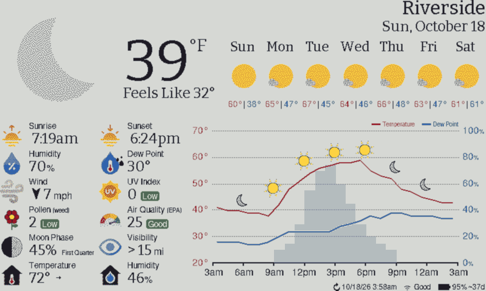
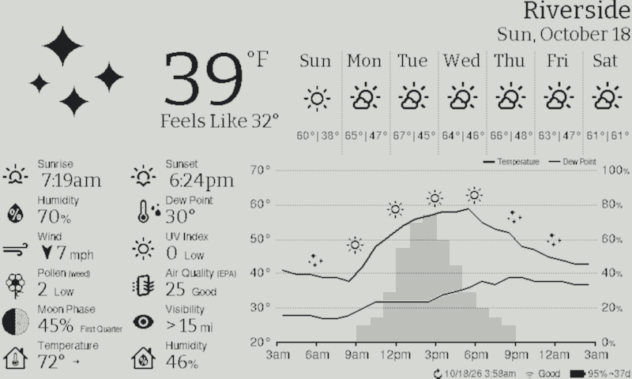
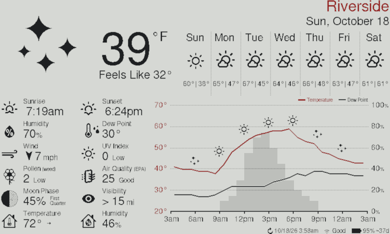
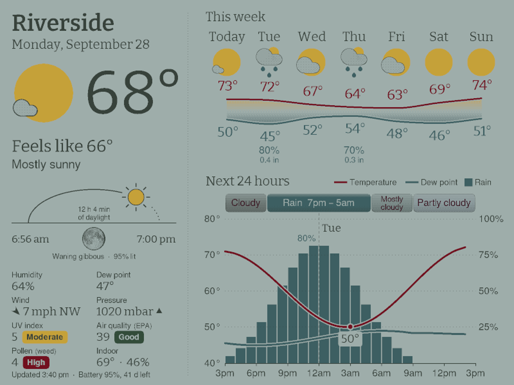
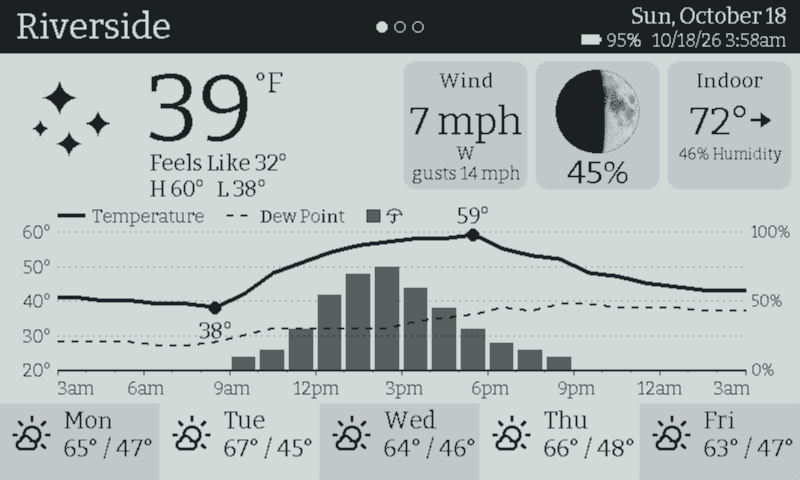
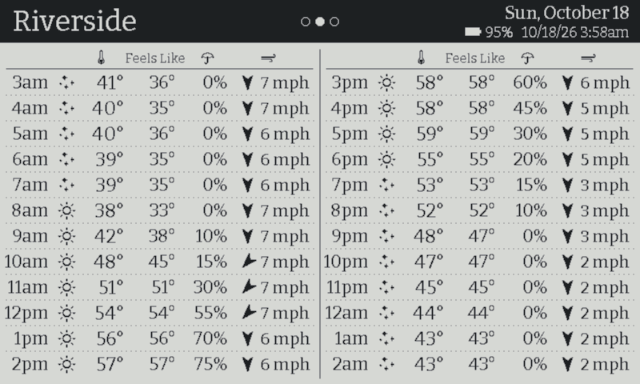
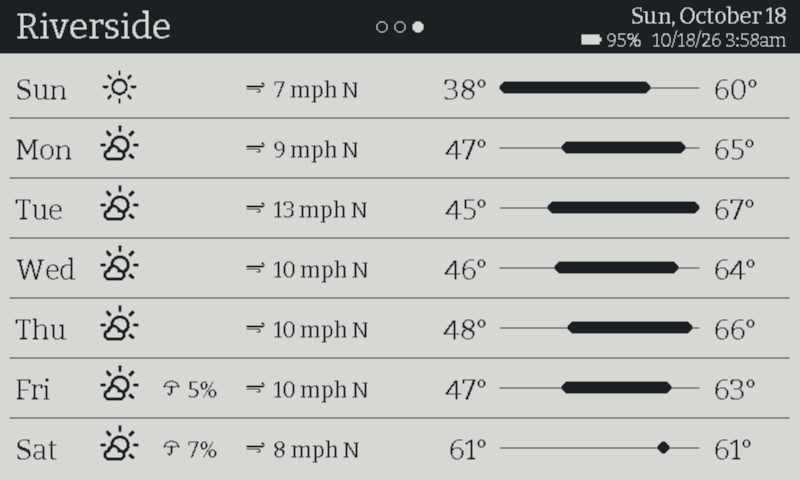
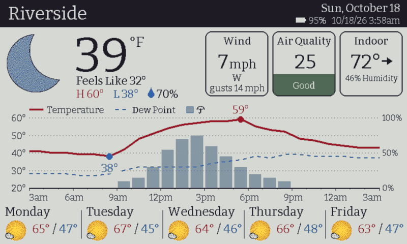

# weathergov-epd — e-paper weather display for ESP32

A low-power weather display for e-paper panels driven by an ESP32. It shows the current conditions, a graph of the next hours, the coming days and weather alerts. It wakes on a schedule, fetches the forecast over WiFi, redraws the panel and goes back to sleep, so a battery lasts months.

This is a fork of [lmarzen/esp32-weather-epd](https://github.com/lmarzen/esp32-weather-epd). Forecasts come from the free, keyless [weather.gov](https://www.weather.gov/documentation/services-web-api) API instead of OpenWeatherMap, everything is set up from a phone, and it runs on several ready-made Seeed devices as well as the original DIY build.



| | | |
|:---:|:---:|:---:|
| [](#75-black-and-white) | [](#75-three-colour-blackwhitered) | [](#73-full-colour-reterminal-e1002) |
| 7.5" black and white | 7.5" three-colour | 7.3" full colour (reTerminal E1002) |
| [](#709-high-resolution-colour-xiao-ee02) | [](#426-four-greys-xiao-ee05) | [](#426-four-greys-xiao-ee05) |
| 7.09" high-resolution colour (XIAO EE02) | 4.26" four greys (XIAO EE05) | 4.26" hours page |

*The previews are drawn by the firmware's own rendering code on a PC (see [Previewing layouts on a PC](#previewing-layouts-on-a-pc)), with sample weather and a made-up afternoon of showers. They use each panel's measured inks, white-balanced to one common white, the way your eye adjusts to a panel in a room. Side by side, the colour panels look darker than the black-and-white ones: they reflect less light.*

## Contents

- [Highlights](#highlights)
- [Supported hardware](#supported-hardware)
- [Layouts](#layouts)
- [Building and flashing](#building-and-flashing)
  - [Build targets](#build-targets)
  - [Compile-time settings](#compile-time-settings)
  - [Flashing over USB](#flashing-over-usb)
  - [Updates over WiFi](#updates-over-wifi)
- [Setup from your phone](#setup-from-your-phone)
- [Configuration reference (config.json)](#configuration-reference-configjson)
- [Assembly](#assembly)
  - [DIY: FireBeetle ESP32 and a 7.5" or 7.3" panel](#diy-firebeetle-esp32-and-a-75-or-73-panel)
  - [Seeed reTerminal E1001 / E1002](#seeed-reterminal-e1001--e1002)
  - [Seeed XIAO EE02 with the 7.09" panel](#seeed-xiao-ee02-with-the-709-panel)
  - [Seeed XIAO EE05 with the 4.26" panel](#seeed-xiao-ee05-with-the-426-panel)
- [Previewing layouts on a PC](#previewing-layouts-on-a-pc)
- [Troubleshooting](#troubleshooting)
- [Licensing and credits](#licensing-and-credits)

## Highlights

- **No API keys or accounts.** weather.gov supplies the hourly and daily forecasts and the alerts (US only). [Open-Meteo](https://open-meteo.com/), also free and keyless, supplies the current conditions, UV and air quality. The forecast can come from Open-Meteo instead, for anywhere in the world, or from the [Israel Meteorological Service](https://ims.gov.il/en). Optional keys add official US air quality ([AirNow](https://docs.airnowapi.org/)) and pollen ([Google](https://developers.google.com/maps/documentation/pollen)).
- **Phone setup, no code editing.** A fresh device opens a WiFi hotspot with a setup page. Every runtime setting can be changed later from a web portal, including firmware updates over WiFi. A USB cable is needed only for the first flash.
- **Layouts for each panel.** The 800×480 layout runs on black-and-white, three-colour and full-colour panels, with colour icons and colour-coded readings where the panel has the inks. The 7.09" and 4.26" panels each have a layout of their own.
- **14 widgets.** Sunrise and sunset (computed on the device), humidity, dew point, heat stress, wind, UV, pressure with its trend, air quality, visibility, moon phase, pollen, and indoor temperature and humidity from an optional sensor.
- **It copes with outages.** The device connects to the strongest access point on mesh networks, and its error screens say why WiFi failed. It retries every 15 minutes. During a short outage the last forecast stays on screen, marked as old, before an error replaces it.
- **Long battery life.** About 14 µA asleep and a few seconds awake per update on the FireBeetle build. The battery level and its estimated days left are on screen, and a low-battery page protects the cell.
- **12 locales,** including Hebrew (right to left, with the Hebrew calendar and Shabbat times) and Polish.

## Supported hardware

| Device | Panel | Layout | Assembly | Build target |
|---|---|---|---|---|
| DFRobot FireBeetle 2 ESP32-E + DESPI-C02 adapter | 7.5" 800×480 black and white (Waveshare v2, Good Display GDEY075T7) | [7.5" black and white](#75-black-and-white) | [Wiring](#diy-firebeetle-esp32-and-a-75-or-73-panel) | `dfrobot_firebeetle2_esp32e` |
| the same | 7.5" 800×480 black/white/red (Waveshare B, Good Display GDEY075Z08) | [7.5" three-colour](#75-three-colour-blackwhitered) | Wiring | `dfrobot_firebeetle2_esp32e` |
| the same | 7.5" 640×384 black and white (v1, GDEW075T8) | reduced 800×480 layout | Wiring | `dfrobot_firebeetle2_esp32e` |
| FireBeetle 2 ESP32-E + **DESPI-C73** adapter | 7.3" 800×480 seven-colour (Waveshare F / GDEY073D46, Spectra 6 GDEP073E01) | [7.3" full colour](#73-full-colour-reterminal-e1002) | Wiring | `dfrobot_firebeetle2_esp32e` |
| [Seeed reTerminal E1002](https://www.seeedstudio.com/reTerminal-E1002-p-6533.html) | built-in 7.3" Spectra 6 | [7.3" full colour](#73-full-colour-reterminal-e1002) | none | `seeed_reterminal_e1002` |
| the same | built-in 7.3" Spectra 6 | [4.26" layout in colour](#426-layout-in-colour-reterminal-e1002) | none | `seeed_reterminal_e1002_426c` |
| Seeed reTerminal E1001 | built-in 7.5" black and white | [7.5" black and white](#75-black-and-white) | none | `seeed_reterminal_e1001` |
| [Seeed XIAO ePaper Display Board EE02](https://www.seeedstudio.com/XIAO-ePaper-Display-Board-EE02-p-6639.html) | Good Display GDEB0709E01, 7.09" 1600×1200 Spectra 6 | [7.09" high resolution](#709-high-resolution-colour-xiao-ee02) | [Panel, optional sensor](#seeed-xiao-ee02-with-the-709-panel) | `seeed_xiao_ee02_709` |
| [Seeed XIAO ePaper Display Board EE05](https://wiki.seeedstudio.com/epaper_ee05) | [Seeed 4.26" 800×480 monochrome](https://www.seeedstudio.com/4-26-Monochrome-SPI-ePaper-Display-p-6398.html) (Good Display GDEQ0426T82) | [4.26" four greys](#426-four-greys-xiao-ee05) | [Printed case](#seeed-xiao-ee05-with-the-426-panel) | `seeed_xiao_ee05` |

The DIY build takes an optional BME280, BME680 or SHT40/41/45 indoor sensor. The reTerminals have an SHT4x built in, and the XIAO boards take an optional SHT40/41/45.

## Layouts

### 7.5" black and white


The original 800×480 layout, drawn in line art. Top left: the current conditions. Below them: up to 12 widgets in a two-column grid, chosen and ordered in the portal. Along the top: a 5- to 7-day forecast. Bottom right: a graph of the next 24 to 48 hours, with temperature (and optionally the dew point) as lines, the chance of rain as bars and the weather as icons along the line. Up to two weather alerts appear at the top, beside the city and date. The status bar shows the update time, WiFi and battery.

It runs on the FireBeetle build with a 7.5" v2 panel, on the reTerminal E1001, and on the EE05 with the `seeed_xiao_ee05_classic` target. A dark mode (white on black) is available on the colour panels.

### 7.5" three-colour (black/white/red)


The same layout with one accent colour, red by default (`ACCENT_COLOR` in config.h): the city name, the temperature line and its scale, and alerts. A full refresh takes about 12 seconds.

### 7.3" full colour (reTerminal E1002)


On the seven-colour and Spectra 6 panels the same layout uses full-colour weather and widget icons. The icons are drawn from the [InkyPi](https://github.com/fatihak/InkyPi) set and reduced to the panel's inks. Highs are red and lows blue, the dew point is a blue curve, and UV, air quality and pollen sit on colour-coded chips. A full refresh takes about 28 seconds. Its white reflects about 40 % as much light as paper, against about 70 % for a black-and-white panel, so next to one it looks greyer than the preview.

### 7.09" high-resolution colour (XIAO EE02)


Good Display's GDEB0709E01 has four times the dots of the 7.3" panels (1600×1200, 282 ppi), so it has a layout of its own:

- **Left:** the city, date and current conditions. Then the sun's path through the day, with sunrise, sunset and the moon at its true phase, rendered from NASA's map of the lunar surface. Then eight readings chosen in the portal (`panel_slots`).
- **Right:** alerts. The week, with each day's highs and lows drawn as one band of smooth curves. Then the next 24 to 48 hours as a timeline of named weather ("Showers 12am – 8am") over a graph of temperature, dew point and chance of rain. Or, chosen in the portal, up to four smaller graphs stacked under the timeline on one time scale: temperature with dew point or feels-like, wind and gusts, rain amount and chance, humidity, cloud cover.
- **At night** the sun's arc shows tomorrow's path and counts down to sunrise.

The layout keeps colour to flat areas, and its colours were measured from test cards scanned on a flatbed: the panel's black is a true black, its blue a royal blue and its white a cool white that reflects about half as much light as paper. A refresh takes about 30 seconds for a mostly white page and up to 50 for one with a lot of colour. English only so far.

### 4.26" four greys (XIAO EE05)

| Home (four greys) | Hours (black and white) | Week (black and white) |
|:---:|:---:|:---:|
|  |  |  |

Seeed's 4.26" panel (219 ppi) is black and white with a waveform for four greys. Its layout comes in pages:

- **Home**, drawn in the four greys on every scheduled update (a full refresh of about 4 s):
  - the current conditions;
  - three tiles chosen in the portal (`home_tiles`), each a title over its reading: wind with gusts; indoor temperature with its trend arrow; air quality; the moon, from NASA's map, lit for its real phase; and others;
  - the next 24 hours as a graph, with the chance of rain on its own 0–100 % scale;
  - five days.
- **Hours** and **Week**, turned to with **KEY3** and drawn in black and white in about 2 s from the weather the last update saved, without the network:
  - Hours: every hour of the next 24, with sky, temperature, feels like, rain chance and wind.
  - Week: seven days with rain, wind and each day's range against the week's.

  The home page comes back five minutes after the last press.

The greys were measured on the panel. Black, dark grey, light grey and white come out at L\* 16, 69, 81 and 100, so the layout also uses checkers of two levels, which at this density read as tones of their own. English only so far.

### 4.26" layout in colour (reTerminal E1002)



The 4.26" layout's home page also runs on the E1002's 7.3" Spectra 6 (`seeed_reterminal_e1002_426c`), in the panel's colours:

- highs and the temperature line in red, lows and the dew point in blue, and the outdoor humidity after a blue drop;
- colour weather icons, made by the 7.09" layout's recipe;
- tiles outlined on white, as dots of grey break up the small text on them; air quality and pollen get a band of the EPA's colour behind their level;
- a full day name over each forecast day;
- alerts in a band under the header, in the warning's own colour where it names one (the Israel Meteorological Service's yellow, orange and red), red otherwise.

It keeps to the home page: a refresh takes about 28 seconds, too long for pages turned by hand. `seeed_reterminal_e1002_426c_he` is the same in Hebrew, mirrored right to left.

## Building and flashing

The firmware is built with [PlatformIO](https://platformio.org/): either the [VS Code extension](https://platformio.org/install/ide?install=vscode) or the command line (`pip install platformio`). Clone or download this repository and open the `platformio` folder.

### Build targets

Each target selects its board, panel, sensor and pins by itself. Only the DIY build needs [compile-time settings](#compile-time-settings) for its panel.

| Target | Hardware |
|---|---|
| `dfrobot_firebeetle2_esp32e` | FireBeetle 2 ESP32-E (USB-C) with a 7.5" panel on a DESPI-C02, or a 7.3" colour panel on a DESPI-C73. The default target; select the panel in config.h. |
| `firebeetle32` | The older micro-USB FireBeetle ESP32. Change `PIN_BAT_ADC` to `A0` and `PIN_EPD_BUSY` to `5` in config.cpp. |
| `seeed_reterminal_e1002` | reTerminal E1002 |
| `seeed_reterminal_e1001` | reTerminal E1001 |
| `seeed_xiao_ee02_709` | XIAO EE02 with the GDEB0709E01 |
| `seeed_xiao_ee05` | XIAO EE05 with the 4.26" panel (four-grey layout with pages) |
| `seeed_xiao_ee05_classic` | XIAO EE05 drawing the 7.5" black-and-white layout instead |
| `seeed_reterminal_e1002_testcard`, `seeed_xiao_ee02_709_testcard`, `seeed_xiao_ee05_testcard` | A test card instead of the weather (inks, greys, type sizes, orientation marks); no WiFi needed. Useful to check a new panel first. |

### Compile-time settings

WiFi, location, time zone, formats, schedule, battery thresholds, weather sources, API keys, fonts and the widget layout are all **runtime settings**. They live in `config.json` and the portal, and need no rebuild ([reference](#configuration-reference-configjson)). Everything in `platformio/src/config.cpp` except the pin assignments has a `config.json` key, so config.cpp only provides the defaults.

What is **compiled in**, and so needs a rebuild to change, is in [`platformio/include/config.h`](platformio/include/config.h):

| Setting | Default | Options and notes |
|---|---|---|
| Panel: `DISP_BW_V2`, `DISP_3C_B`, `DISP_7C_F`, `DISP_7C_E6`, `DISP_BW_V1` | `DISP_BW_V2` | DIY build only; the Seeed targets set their own. |
| Driver board: `DRIVER_DESPI_C02`, `DRIVER_WAVESHARE` | `DRIVER_DESPI_C02` | Keep `DRIVER_DESPI_C02` for a DESPI-C73 too: the setting only sets the length of the reset pulse. Waveshare's HATs (rev 2.2/2.3) are deprecated. |
| Indoor sensor: `SENSOR_BME280`, `SENSOR_BME680`, `SENSOR_SHT4X`, `SENSOR_NONE` | `SENSOR_BME280` | DIY build only; the Seeed targets set their own. `SENSOR_INIT_DELAY_MS 300` if the BME280 reads nothing. |
| `LOCALE` | `en_US` | `de_DE`, `en_GB`, `es_ES`, `et_EE`, `fi_FI`, `fr_FR`, `he_IL`, `it_IT`, `nl_BE`, `pl_PL`, `pt_BR`. A locale can bring its own unit and font defaults (`include/locales/locale_<code>.defaults.h`). |
| Temperature: `UNITS_TEMP_FAHRENHEIT`, `_CELSIUS`, `_KELVIN` | Fahrenheit | |
| Wind: `UNITS_SPEED_MILESPERHOUR`, `_KILOMETERSPERHOUR`, `_METERSPERSECOND`, `_FEETPERSECOND`, `_KNOTS`, `_BEAUFORT` | mph | |
| Pressure: `UNITS_PRES_MILLIBARS`, `_HECTOPASCALS`, `_INCHESOFMERCURY`, `_MILLIMETERSOFMERCURY`, `_PASCALS`, `_ATMOSPHERES`, … | mbar | |
| Visibility: `UNITS_DIST_MILES`, `_KILOMETERS` | miles | |
| Daily precipitation: `UNITS_DAILY_PRECIP_INCHES`, `_MILLIMETERS`, `_CENTIMETERS`, `_POP` | inches | Amounts come from weather.gov's gridpoint forecast for about 3 days, then Open-Meteo. `_POP` shows the chance instead (and saves one large request per update). |
| Fonts: `FONT_INCLUDE_<Family> 1` | FreeSans (+ Bitter on the reTerminals and EE05) | Each family costs 150–250 KB of flash; the families compiled in are offered in the portal. Add a TTF with `tools/fontconvert.py` and `tools/gen_font_table.py`. |
| `ACCENT_COLOR` | `GxEPD_RED` | The three-colour panel's accent. |
| `COLOR_SUN`, `COLOR_PRECIP`, `COLOR_TEMP_HI`, … | yellow, blue, red, … | The full-colour panels' palette, by meaning. |
| `WIND_INDICATOR_*`, `WIND_ICONS_*` | arrow, 16 directions | Arrow, degrees or compass points; the arrow's precision. |
| `TEMP_ORDER_HL` / `TEMP_ORDER_LH` | high first | |
| `DISPLAY_DAILY_PRECIP` | `2` (only when forecast) | `0` never, `1` always. |
| `DISPLAY_HOURLY_ICONS`, `DISPLAY_ALERTS` | `1` | `0` hides them. |
| `STATUS_BAR_EXTRAS_*` | battery %, WiFi strength | Battery voltage and RSSI can be added. |
| `BATTERY_MONITORING` | `1` | `0` for a display without a battery. |
| `EPD709_ROTATION` | `1` | GDEB0709E01 only: `3` if the picture is upside down. |
| `DEBUG_LEVEL` | `0` | `1` more serial output, `2` also the API replies. |
| `SIMULATE_OUTAGE`, `FORCE_PORTAL` | off | For testing only. |

Ways to set them:

- **Edit config.h**.
- **Pass them on the command line, which leaves the file alone:**

  ```
  PLATFORMIO_BUILD_FLAGS="-D LOCALE=he_IL" pio run -e seeed_reterminal_e1002
  PLATFORMIO_BUILD_FLAGS="-D DISP_3C_B -D SENSOR_SHT4X" pio run
  ```

  With `-D LOCALE=he_IL`, Hebrew's defaults file switches to metric units, Israel's time zone and the Heebo font.
- **Pins:** set them in `platformio/src/config.cpp`. Only the DIY build has a choice; the defaults match the wiring diagram, and the Seeed boards' pins are fixed.
- **Certificates:** the servers' certificates are checked against the root CAs in `cert.h`, valid until 2035. To build without verification, create `platformio/include/config_local.h` containing `#define USE_HTTPS_NO_CERT_VERIF`. Git ignores that file.

### Flashing over USB

```
pio run -e <target> -t upload             # build and flash the firmware
pio run -e <target> -t upload --upload-port COM5   # if more than one port is attached
pio run -e <target> -t uploadfs           # optional: write data/config.json to the device
```

In VS Code, pick the target in the status bar and use **PlatformIO: Upload**.

A freshly flashed device needs no filesystem upload. It formats its storage, finds no WiFi settings and opens the setup hotspot ([Setup from your phone](#setup-from-your-phone)). `uploadfs` is only for preloading a prepared `data/config.json`, and it replaces the one on the device.

Notes per board:

- **FireBeetle 2 ESP32-E:** if the upload stops with `Wrong boot mode detected (0x13)`, unplug the board, connect GPIO0 (labelled 0/D5) to GND, and plug it back in. Other upload errors usually mean a missing USB-serial driver.
- **reTerminal E1001 / E1002:** they flash through their own USB-serial chip (a CH340). If the upload cannot connect while the display sleeps, press the reset button and try again.
- **XIAO EE02 / EE05:** the USB port is the ESP32-S3's own, and serial output appears there. While a computer is attached, the board waits awake between updates instead of sleeping, so it can be flashed and its log read at any time. If no port appears (the board was asleep), press RST once. Some power banks switch themselves off at the tiny current the board draws asleep.
- **Test cards:** flash a test card target before the weather on a new panel. It shows the inks or greys, a ladder of type sizes and named corners, so one look tells you whether the picture is the right way up.

### Updates over WiFi

After the first flash, updates go through the portal:

1. Build: `pio run -e <target>`.
2. In the portal, under **Firmware update**, choose `.pio/build/<target>/firmware.bin` and tap **Upload & Install**. The portal shows the running build's commit and date.

The new image goes into a spare flash slot and takes effect only once it has been received and verified, so an interrupted upload leaves the running firmware alone. Every build records its target and panel, and the portal refuses a file built for another board or panel unless you tick **Install even if...**. The settings page is part of the firmware, so an update brings its own page and leaves the device's `config.json` as it is.

## Setup from your phone

A device without WiFi settings starts its own hotspot and shows how to reach it on the panel:

1. On your phone, join **`WeatherEPD-Setup`** (password **`weatherepd`**).
2. The setup page should open by itself. If it doesn't, browse to **http://192.168.4.1/**.
3. Fill in the page:
   - **WiFi:** tap **Scan** to list networks, strongest first. 2.4 GHz only.
   - **Location:** tap **Detect my location**, or enter latitude and longitude.
   - **Time zone and formats:** dropdowns with live examples.
   - The rest (schedule, forecast days, widgets, API keys) can be set now or later.
4. Tap **Save & Restart**. The weather appears within a minute or two.

If setup isn't finished within 10 minutes, the device shows "Setup paused" and sleeps to save the battery; press reset to start again.

**Opening the portal later.** Once configured, the portal is reachable at `http://weatherepd.local/` or the device's IP for 10 minutes (adjustable) after you open it:

| Device | Open the portal | Refresh now | Other buttons |
|---|---|---|---|
| FireBeetle DIY build | Press RST **twice**, one to three seconds apart, after the panel has finished refreshing | RST once | |
| reTerminal E1001 / E1002 | Middle button | Green (right) button | |
| XIAO EE02 | KEY1 | KEY2 | KEY3 unused |
| XIAO EE05 | KEY1 | KEY2 | KEY3 turns the page; RST restarts |

What the portal offers:

- **Every setting**, in a form: WiFi with a scan, location with phone GPS, time zone and formats, schedule and bedtime, forecast days, and the widget layout as a picture of the panel.
- **A raw JSON editor** for the rest (battery thresholds, NTP servers, portal options). Saves are checked on the device and keep a backup (`config.bak`).
- **Diagnostics:** what the display did on its last wake and on the last one that failed: the result, how long WiFi, the weather requests and the screen took, the battery voltage and the WiFi signal.
- **Firmware update** ([above](#updates-over-wifi)).

## Configuration reference (config.json)

All runtime settings live in [`platformio/data/config.json`](platformio/data/config.json) on the device, with `//` comments explaining every option. You can change them three ways:

- in the portal;
- by editing the file and running `pio run -t uploadfs`;
- by deleting a key, which falls back to the default compiled into `config.cpp`.

<details>
<summary><b>Weather sources and API keys</b></summary>

- `api.forecast_source`: where the forecasts, condition icons and alerts come from.
  - `"nws"` (default) is weather.gov, US only.
  - `"open-meteo"` is worldwide and keyless, with a 7-day forecast, hourly temperature, humidity, rain chance, wind and condition codes, and daily rain totals. It has no alerts.
  - `"ims"` is the Israel Meteorological Service: hourly forecasts and regional warnings, Israel only. Replies follow the firmware's language. `api.ims_location_id` picks one of IMS's ~160 locations ([list](https://ims.gov.il/en/locations_info)); `0` takes the nearest. IMS times are Israel time, so set `timezone` to match.
- `api.current_source`: where the current conditions come from.
  - `"open-meteo"` (default) is Open-Meteo's model at your coordinates, updated about every 15 minutes.
  - `"google"` is the [Google Weather API](https://developers.google.com/maps/documentation/weather)'s station-blended nowcast, using `pollen_api_key`.
  - `"nws"` is weather.gov's forecast for the current hour: no extra request, but no pressure or visibility.

  If the source fails, the display falls back to the hourly forecast and the last cached values.
- `api.aqi_source`: where the air quality index comes from.
  - `"auto"` (default): Israel's Ministry of Environmental Protection with IMS, else AirNow when its key is set, else Open-Meteo's model.
  - `"airnow"`, `"israel"` or `"model"` force one.

  The Israeli index is the worst current value among stations within 15 km; `api.il_aq_station_id` pins a single station.
- `api.nws_user_agent`: weather.gov asks for a contact email in the User-Agent, so they can reach you if your device misbehaves. Please set one.
- `api.airnow_api_key`: optional. A free [AirNow key](https://docs.airnowapi.org/) gives the EPA's official measured US AQI.
- `api.pollen_api_key`: optional. A Google Maps Platform key with the Pollen API enabled turns on the pollen widget. The same key serves `current_source: "google"` when the Weather API is enabled on its project.

</details>

<details>
<summary><b>What the display shows</b></summary>

- `widget_positions`: the 800×480 layouts' 14 widgets: sunrise, sunset, humidity, dewpoint, heat_stress, wind, uvi, pressure, air_quality, visibility, moon_phase, pollen, intemp, inhumidity. Each gets a slot number (0, 1 in the top row, 2, 3 in the next…), or `-1` to hide it.
- `widget_rows`: `5` (10 slots) or `6` (12 slots).
- `forecast_days`: 5 to 7 days in the forecast row.
- `sleep.hourly_graph_max`: hours on the graph, 8 to 48.
- `graph_dewpoint`: adds the dew point as a second curve on the graph.
- `font`, `font_small`: the typeface for the text, and a separate one for the small text (labels, axis, tags). Only families compiled in are available. On ~125 ppi panels, Bitter with FreeSans below is the intended pairing.
- `dark_mode`: white on black, on the colour panels.
- `panel_slots` (7.09" layout): its eight readings.
- `graph_layout` (7.09" layout): `one` for the one hourly graph, `stacked` for smaller graphs stacked under the timeline, chosen top to bottom in `graph_slots` from temp, temp_dew, temp_feels, feels, dew, wind, rain, amount, rain_both, rain_clouds (with cloud cover behind), humidity and clouds. `graph_strip`: `false` hides the strip of named weather, and the graph(s) take its room. weather.gov gives rain amounts only as 6-hour totals; each hour gets a share of its total by its chance of rain.
- `home_tiles` (4.26" layout): its three home tiles, from wind, air_quality, indoor, intemp, inhumidity, humidity, dewpoint, heat_stress, pressure, uvi, pollen, visibility, sun and moon_phase.
- `time.time_format`, `hour_format`, `date_format`, `refresh_time_format`: strftime formats, with dropdowns in the portal. `%K` / `%J` add the Hebrew calendar date, and `%Q` the holiday's name on the day.
- `heat_stress` widget: the Israel Meteorological Service's discomfort index, with its level on a colour chip. Hidden by default, except in a Hebrew build, where it takes the dew point's slot.

</details>

<details>
<summary><b>Schedule, power and network</b></summary>

- `sleep.sleep_duration_minutes`: time between updates (default 15).
- `sleep.bed_time_hour`, `sleep.wake_time_hour`: no updates between these hours (default midnight to 5 am).
- `sleep.wifi_retry_interval_minutes`: how soon to retry after a failed connection (default 15).
- `sleep.outage_grace_minutes`: how long the last weather stays on screen, marked as old, before an error screen replaces it (default 180; `0` shows errors at once). Only timer wakes hold the screen; after a button press or reset an error is shown straight away.
- `battery.*`: the low-battery thresholds, in millivolts (warn 3535, low 3462, very low 3442, critical 3404), and the sleep intervals while low (30 and 120 minutes).
- `wifi.static_ip`, `gateway`, `subnet`, `dns`: a static address skips DHCP, saving 2–4 s per wake. It is used only on the network it was set for (`wifi.static_ssid`, which the portal fills in); on any other network the display uses DHCP, and choosing another network in the portal clears the static address.
- `wifi.timeout_ms`, `time.ntp_server_1`/`_2`, `time.ntp_timeout_ms`, `api.http_client_tcp_timeout_ms`: network timeouts and time servers.
- `portal.ap_password`, `portal.timeout_minutes`: the setup hotspot's password, and how long the portal stays open.

</details>

<details>
<summary><b>Languages: Hebrew, Polish and the rest</b></summary>

- **Choosing the language:** set `LOCALE` at build time ([compile-time settings](#compile-time-settings)). Each locale can bring its own defaults: units, time zone and font.
- **Hebrew (`he_IL`):**
  - It switches on the Heebo family, and lays each line out right to left, numbers and Latin words keeping their order.
  - The forecast row runs right to left, with day names spelt out where they fit. Units use the Israeli abbreviations.
  - With IMS as the source, the current conditions get a short description, and IMS's warnings are shown as IMS words them.
  - The setup portal comes up in Hebrew too ([screenshot](showcase/portal-he.png)).
  - Previews: [Netanya](showcase/preview-netanya-he.png), [an alert](showcase/preview-netanya-he-alert.png), [black and white](showcase/preview-netanya-he-bw.png).
- **Shabbat and holidays:**
  - On Friday and on the eve of a holiday, the sunset widget shows candle lighting (sunset less `shabbat.candle_lighting_minutes`, default 18).
  - On Shabbat and holidays it shows when they end (sunset plus `shabbat.havdalah_minutes`, default 42).
  - Holidays follow the Israeli calendar. `shabbat.show` forces it on or off; a Hebrew build has it on.
  - Previews: [Friday](showcase/preview-netanya-he-friday.png), [Shabbat](showcase/preview-netanya-he-shabbat.png).
- **Polish (`pl_PL`):** it draws through a Latin-2 font family (Lato CE), so every Polish letter shows, and it switches to metric units. Use Open-Meteo as the forecast source. Previews: [Kraków](showcase/preview-krakow-pl.png), [afternoon](showcase/preview-krakow-pl-afternoon.png).

</details>

## Assembly

### DIY: FireBeetle ESP32 and a 7.5" or 7.3" panel

<p float="left">
  
  
</p>

**Parts** (some links are the upstream author's affiliate links):

| Part | Notes |
|---|---|
| [FireBeetle 2 ESP32-E](https://www.dfrobot.com/product-2195.html?tracking=PfSxQ8) | Low-power board with USB-C and battery charging. A [version with headers](https://www.dfrobot.com/product-2231.html?tracking=PfSxQ8) allows a solder-free build. |
| An e-paper panel | See [Supported hardware](#supported-hardware). Waveshare and Good Display panels are equivalent. |
| Adapter: [DESPI-C02](https://www.aliexpress.us/item/3256804446769469.html) for a 7.5" panel, DESPI-C73 for a 7.3" colour panel | The 7.5" panels have a 24-pin ribbon. The 7.3" colour panels have a 50-pin one, which only the DESPI-C73 takes. Waveshare's HATs (rev 2.2/2.3) are not recommended. |
| Indoor sensor (optional): BME280, BME680 or SHT40/41/45 | Temperature and humidity. The BME280 is the default; for another, set `SENSOR_BME680` or `SENSOR_SHT4X` ([compile-time settings](#compile-time-settings)). Buy one with headers for a solder-free build. |
| 3.7 V LiPo with a JST-PH 2.0 plug | Any capacity; 5000 mAh lasts about 6–12 months at a 30-minute interval. |
| Wires, a soldering iron, optionally a reset button for the enclosure | |

**Wiring:**


The DESPI-C02 and the DESPI-C73 have the same eight header pins, and the three sensors the same four, so the diagram holds for all of them:

| DESPI-C02 or DESPI-C73 | FireBeetle 2 ESP32-E |
|---|---|
| BUSY | 14 |
| RES | 21 |
| D/C | 22 |
| CS | 13 |
| SCK | 18 |
| SDI | 23 |
| GND | GND |
| 3.3V | 3V3 |

| BME280, BME680 or SHT4x | FireBeetle 2 ESP32-E |
|---|---|
| VIN | 4 (powers the sensor only while it's read) |
| GND | GND |
| SCL | 16 |
| SDA | 17 |

- **Adapter switch:** set the DESPI-C02's RESE switch to **0.47**. The DESPI-C73 has none. For a Waveshare HAT, set Display Config to **B** and Interface Config to **0**. Rev 2.3 has an extra PWR pin, which goes to 3.3 V.
- **The DESPI-C73's ribbon connector:** lift its black lever before sliding the panel's 50-pin ribbon in, then press the lever down firmly. A ribbon that isn't fully seated can leave the panel blank.
- **Battery polarity:** JST-PH 2.0 plugs aren't standardised, so check yours, and swap the wires in the plug if needed. The battery charges whenever the board has USB-C power.
- **Low-power pad:** for longer battery life, cut the FireBeetle's low-power pad (see [DFRobot's wiki](https://wiki.dfrobot.com/FireBeetle_Board_ESP32_E_SKU_DFR0654)). That saves about 500 µA, and sleep current falls to about 13 µA.
- **Pins:** the diagram's pins are the defaults in `config.cpp`. If you wire differently, change them there.

**Enclosures:** the community has designed many 3D-printed cases for this build:

- [Kingfisher](https://www.printables.com/model/1139047-weather-station-e-ink-frame)
- [Francois Allard](https://www.printables.com/model/791477-weather-station-using-a-esp32)
- [3D Nate](https://www.printables.com/model/661183-e-ink-weather-station-frame)
- [Sven F.](https://www.printables.com/model/657756-case-for-esp32-weather-station)
- [Layers Studio](https://www.printables.com/model/655768-esp32-e-paper-weather-display-stand)
- [PJ Veltri](https://www.printables.com/model/692944-base-and-display-holder-for-esp-32-e-paper-weather)
- [TheMeanCanEHdian](https://www.printables.com/model/841458-weather-display-enclosure)
- [MPHarms](https://www.thingiverse.com/thing:6666148)
- [Plaste-Metz](https://www.printables.com/model/1160924-weather-station-case)
- [kenwch92](https://www.printables.com/model/1505838-over-engineered-display-stand-for-esp32-e-paper-we)
- [Eckerput](https://www.thingiverse.com/thing:7112836)
- [Thomax](https://www.printables.com/model/1363448-esp32-e-paper-weather-display)

Upstream's own case is a wooden stand: 63 mm deep, 49 mm high and 170.2 mm wide (the screen's width), with the screen at 80° and 15 mm from the front. It has a USB extension for charging, a reset button and a magnetic printed bottom cover. A thin acrylic sheet supports the panel.

### Seeed reTerminal E1001 / E1002

No assembly: the panel, battery, buttons, SHT4x sensor and case are built in. Flash `seeed_reterminal_e1002` (or `_e1001`) and set it up from your phone.

### Seeed XIAO EE02 with the 7.09" panel

- **Panel:** the GDEB0709E01's 60-pin cable plugs straight into the EE02.
- **Indoor sensor (optional, four wires):** the EE02 has no sensor and no free pins. Without one, the Indoor cell shows visibility. An SHT40, SHT41 or SHT45 breakout (3.3 V, with its own pull-ups) can be soldered to the pads of **U6**, an empty eight-pad footprint between the buttons and the flash chip. The firmware looks for it on every wake.

  | Sensor | U6 pad | Signal |
  |---|---|---|
  | VIN / 3V3 | 8 | 3.3 V, switched with the panel supply (GPIO43) |
  | SCL | 6 | GPIO11 |
  | SDA | 5 | GPIO13 |
  | GND | 4 | ground |

  - **Finding the pads:** with the USB-C connector at the top right, the footprint's top row is pads 8, 7, 6, 5 from left to right, and its bottom row 1, 2, 3, 4.
  - **Check ground first:** confirm with a meter that pad 4 is ground (the USB connector's shell).
  - **Never 5 V:** the board's pins are 3.3 V.
  - **Placement:** keep the sensor on a few centimetres of wire, away from the board's warmth.
- **Battery:** the reading assumes a 1:2 divider; check it against a meter. With no battery, the charger's green LED blinks, which is normal.
- **Panel care:** Good Display asks for a refresh at least once a day and at least 150 s between refreshes, with no outdoor or direct-sun use.

### Seeed XIAO EE05 with the 4.26" panel

The EE05 fits a 3D-printed case: a remix of Seeed Studio's own enclosure for this kit ([original on GrabCAD](https://grabcad.com/library/opendisplay-4-2_6-in-mono-kit-xiao-en05-epaper-board-4-2_6-in-epaper-display-1)). The remix adds:

- heat-set inserts;
- a vented chamber for an SHT41;
- ribs that hold a 654060 2000 mAh battery;
- a pocket for the antenna;
- a slightly wider screen window;
- button labels engraved in the back.

The STL files and a print guide are on Printables.

**Parts:**

| Qty | Part | Notes |
|---|---|---|
| 1 | Seeed XIAO ePaper Display Board EE05 | Includes the XIAO ESP32-S3 Plus and its FPC antenna. |
| 1 | Seeed 4.26" monochrome SPI ePaper display | Comes with the 24-pin FPC adapter and flat cable. |
| 1 | LiPo 654060, 3.7 V, ~2000 mAh, JST-PH 2.0 (optional) | **Check the polarity** against the + mark on the board's BAT connector; many cells are wired the other way. |
| 1 | SHT40/41/45 breakout with one M2 hole (optional) | Up to about 17 × 13 mm. |
| 4 | 28 AWG silicone wire, ~13 cm | For the sensor. |
| 4 + 4 | M3 heat-set inserts (4.4 mm hole) and M3 × 8 screws | Frame corners, through the back cover. |
| 5 + 5 | M2 heat-set inserts (3.4 mm hole) and M2 × 4 screws | The board's four standoffs and the sensor post. |

**Print settings:** PLA or PETG, 0.2 mm layers, 3 walls, 15–20 % infill, no supports. The files are already oriented for the bed. The lid's engraved labels print best with a 0.25 mm nozzle.

**Assembly:**

1. **Inserts:** heat-set the M3 inserts into the frame's corner posts. Heat-set the M2 inserts into the support plate's four board standoffs and its sensor post.
2. **Firmware:** flash `seeed_xiao_ee05` before closing the case.
3. **Panel:** lay the frame face down and drop the panel in, with its ribbon toward the board's display connector.
4. **Support plate:** lay it on the panel. Fold the ribbon gently around its edge into the FPC adapter, and run the 24-pin cable to the board.
5. **Board:** screw the EE05 to the standoffs, components facing away from the panel. Connect and lock the flat cable.
6. **Antenna:** stick the FPC antenna in the pocket inside the back cover. Route its cable through the corner notch to the XIAO's u.FL socket.
7. **Sensor (optional):**
   - Screw it to the chamber's post, chip facing the vents.
   - Run its wires through the chamber notch, under the battery and through the notch above the battery connector.
   - Solder them: SDA to the XIAO's D4 (GPIO5), SCL to D5 (GPIO6), 3V3 to 3V3, GND to GND. The extension pads work too: J2 pin 1 SDA, J2 pin 2 SCL, J4 pin 5 3.3 V, J4 pin 6 GND.
8. **Battery (optional):** seat it between the support plate's ribs. Check the polarity and plug it in.
9. **Back cover:** fit it so the plungers line up with the four side buttons, and fasten it with the M3 screws.
10. **Switch and lid:** put the switch cap on the slide switch, then press the lid onto the board box (a friction fit).
11. **Stand:** clip the stand into its holder, or hang the case on a screw by its keyhole.

The lid's labels are the buttons: **SETUP** (KEY1, portal), **REFRESH** (KEY2), **PAGE** (KEY3) and **RESET**.

## Previewing layouts on a PC

Two tools build the firmware's own drawing code for a computer and save what it draws as pictures, in each panel's measured inks. That's how the previews above were made, with `--balance`, which white-balances every panel to the same white.

- **[tools/sim480](tools/sim480/README.md):** the 800×480 layouts, plus the 4.26" pages.
  - `--panel=` picks the panel: `e6` (Spectra 6), `bwv2` (black and white), `3c` (three-colour) or `4g426` (EE05).
  - `--locale=en_US` draws a real device's page from its own config.json and replies saved by `fetch_us.py`. Other locales draw saved sample data for Israel or Kraków.
  - `SIM480_RAIN=1` adds made-up showers.
- **[tools/sim709](tools/sim709/README.md):** the 7.09" layout, with sample weather: day, night, alerts, dark mode, errors.

Both need Python with Pillow (and numpy for sim480) and a C++17 compiler: g++ or clang++, or MinGW-w64 on Windows.

## Troubleshooting

During an outage, the last weather stays on screen, marked as old, for `sleep.outage_grace_minutes` (default 3 hours). Only then do the error screens below replace it. After a button press or reset, an error shows at once. The portal's **Diagnostics** section has the details of the last failure. To see the outage behaviour without unplugging your router, build once with `SIMULATE_OUTAGE` defined.


**Low battery.**

- **When:** below `low_voltage_mv` (default 3.462 V, about 10 %).
- **What happens:** the low-battery page stays until the battery is charged, drawn in black on white and redrawn once a day. While low, the device checks every 30 minutes, or every 120 minutes below `very_low_voltage_mv`.
- **Critical:** below `crit_low_voltage_mv` (3.404 V) it hibernates until reset.

<br clear="left"/>


**WiFi connection.** The second line says why: wrong password, network not found, no response, and so on. The device retries every `wifi_retry_interval_minutes` (default 15) and recovers by itself. On mesh networks it picks the strongest access point.

<br clear="left"/>


**API error.** A request to weather.gov or Open-Meteo failed. The code is the HTTP status, or a client error if it's 0 or less. The device retries at the next update. AirNow failures never show here: the air quality falls back to Open-Meteo.

<br clear="left"/>


**Time server error.** The time couldn't be fetched from `ntp_server_1`/`_2`. This sometimes happens right after a flash; press reset or wait for the retry. If it persists, choose closer time servers or raise `ntp_timeout_ms`.

<br clear="left"/>

## Licensing and credits

weathergov-epd is a fork of [esp32-weather-epd](https://github.com/lmarzen/esp32-weather-epd) by Luke Marzen, and like it is licensed under the [GNU General Public License v3.0](LICENSE). The EE05 case is a remix of Seeed Studio's enclosure. Bundled tools, fonts and icons:

| Name | License | Description |
|---|---|---|
| [Adafruit-GFX-Library: fontconvert](https://github.com/adafruit/Adafruit-GFX-Library/tree/master/fontconvert) | [BSD License](fonts/fontconvert/license.txt) | Preprocesses fonts for the Adafruit_GFX library. |
| [pollutant-concentration-to-aqi](https://github.com/lmarzen/pollutant-concentration-to-aqi) | [GNU LGPL v2.1](platformio/lib/pollutant-concentration-to-aqi/LICENSE) | Converts pollutant concentrations to an AQI. |
| [InkyPi weather icons](https://github.com/fatihak/InkyPi) | [GNU GPL v3.0](https://github.com/fatihak/InkyPi/blob/main/LICENSE) | Full-colour icon artwork by Faith Akici, reduced to e-paper inks by tools/generate_color_icons.py. |
| [NASA LRO lunar map](https://svs.gsfc.nasa.gov/4720) | Public domain | The moon on the 7.09" and 4.26" layouts (tools/moon). |
| [Bitter](https://fonts.google.com/specimen/Bitter), [Lato](https://fonts.google.com/specimen/Lato), [Montserrat](https://fonts.google.com/specimen/Montserrat), [Open Sans](https://fonts.google.com/specimen/Open+Sans), [Poppins](https://fonts.google.com/specimen/Poppins), [Quicksand](https://fonts.google.com/specimen/Quicksand), [Raleway](https://fonts.google.com/specimen/Raleway), [Heebo](https://fonts.google.com/specimen/Heebo) | [SIL OFL v1.1](http://scripts.sil.org/OFL) | Font families |
| [GNU FreeFont](https://www.gnu.org/software/freefont/) | [GNU GPL v3.0](https://www.gnu.org/software/freefont/license.html) | Font family |
| [Roboto](https://fonts.google.com/specimen/Roboto), [Roboto Mono](https://fonts.google.com/specimen/Roboto+Mono), [Roboto Slab](https://fonts.google.com/specimen/Roboto+Slab) | [Apache License v2.0](https://www.apache.org/licenses/LICENSE-2.0) | Font families |
| [Ubuntu font](https://design.ubuntu.com/font) | [Ubuntu Font Licence v1.0](https://ubuntu.com/legal/font-licence) | Font family |
| [Weather Themed Icons](https://github.com/erikflowers/weather-icons) | [SIL OFL v1.1](http://scripts.sil.org/OFL) | (wi-**.svg) Weather icons by Lukas Bischoff/Erik Flowers. |
| [Google Icons](https://fonts.google.com/icons) | [Apache License v2.0](https://www.apache.org/licenses/LICENSE-2.0) | (battery**.svg, visibility_icon.svg) Battery and visibility icons. |
| [Biological Hazard Symbol](https://svgsilh.com/image/37775.html) | [CC0 v1.0](https://en.wikipedia.org/wiki/Public_domain) | (biological_hazard_symbol.svg) |
| [House Icon](https://seekicon.com/free-icon/house_16) | [MIT License](http://opensource.org/licenses/mit-license.html) | (house.svg) |
| [Indoor temperature/humidity icons](icons/svg) | [SIL OFL v1.1](http://scripts.sil.org/OFL) | (house_**.svg) |
| [Ionizing Radiation Symbol](https://svgsilh.com/image/309911.html) | [CC0 v1.0](https://creativecommons.org/publicdomain/zero/1.0/) | (ionizing_radiation_symbol.svg) |
| [Phosphor Icons](https://github.com/phosphor-icons/homepage) | [MIT License](http://opensource.org/licenses/mit-license.html) | (wifi**.svg, warning_icon.svg, error_icon.svg) |
| [Wind Direction Icon](https://www.onlinewebfonts.com/icon/251550) | [CC BY v3.0](http://creativecommons.org/licenses/by/3.0) | (meteorological_wind_direction_**deg.svg) |
